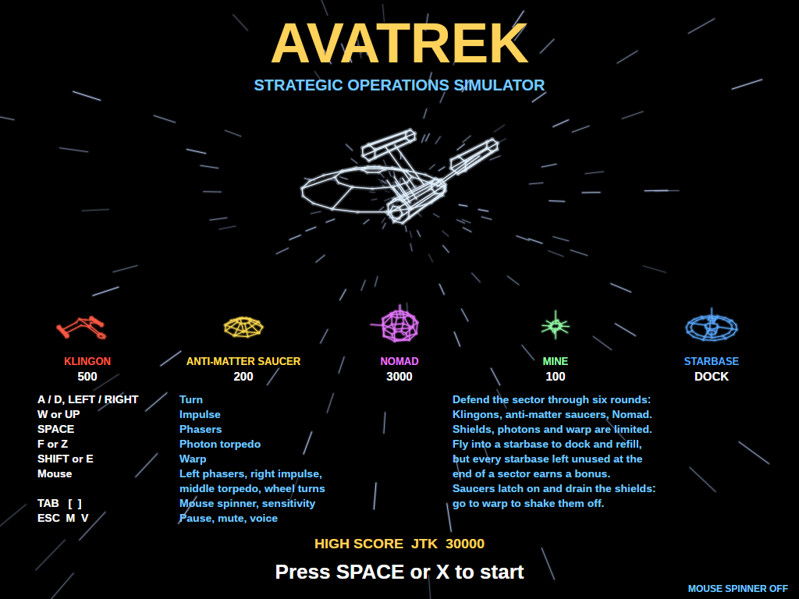
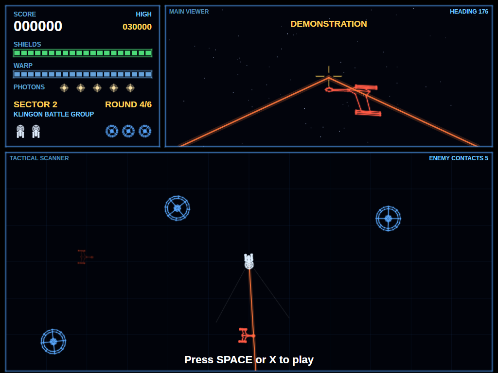
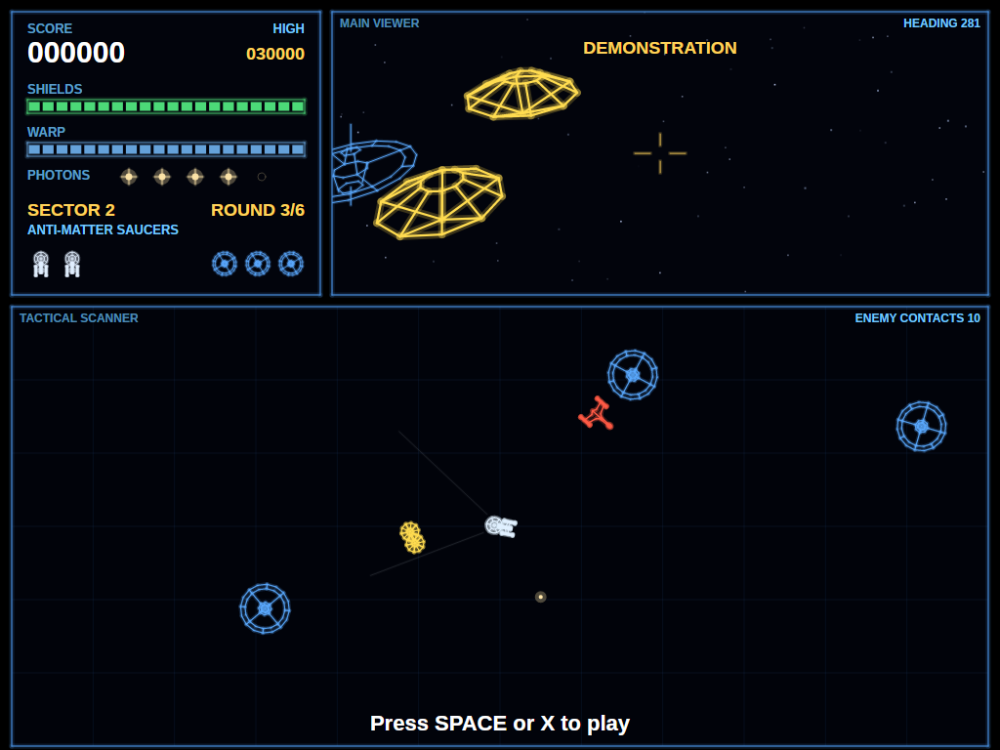
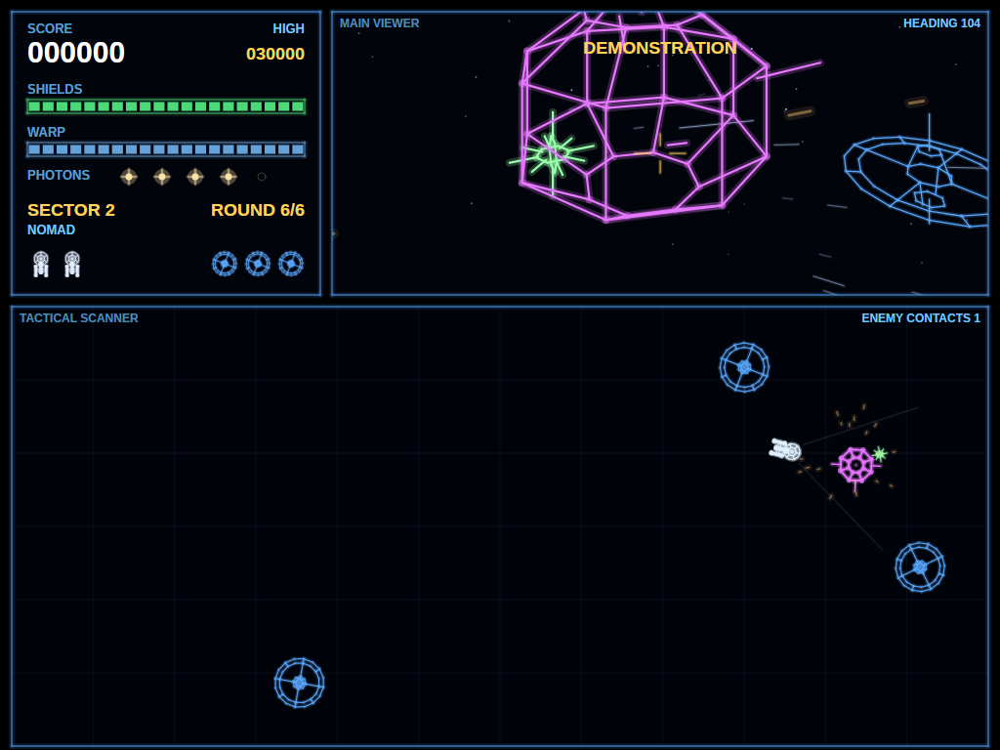
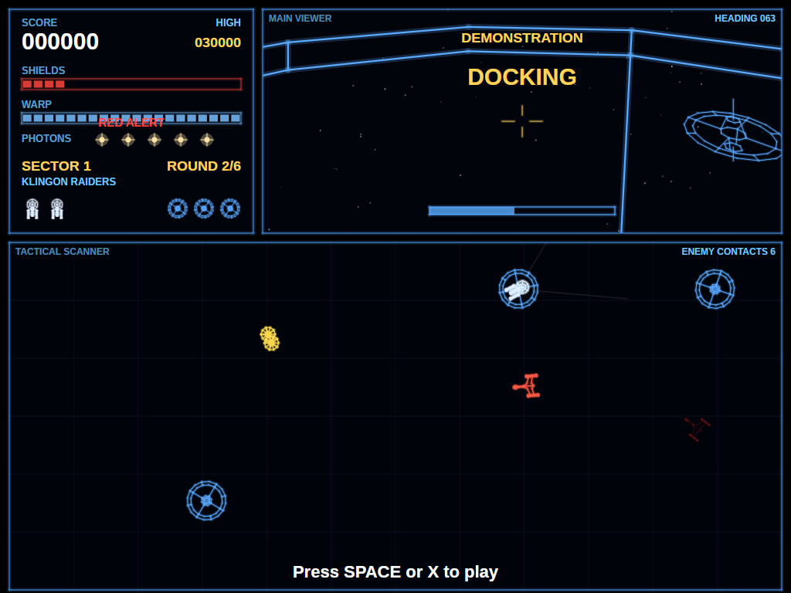
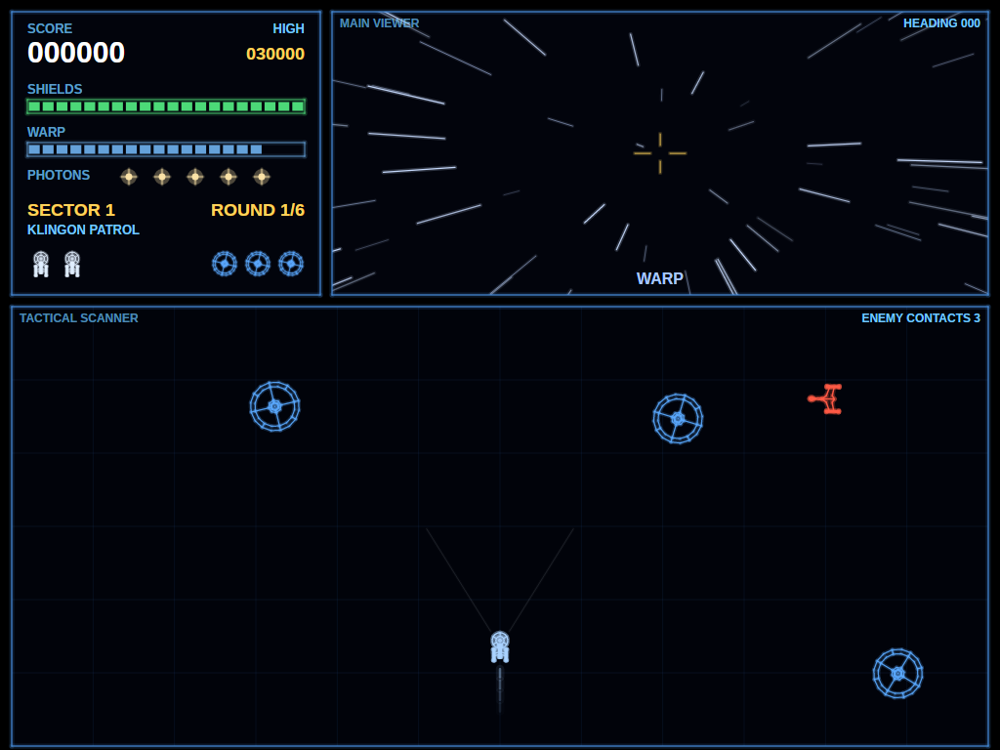
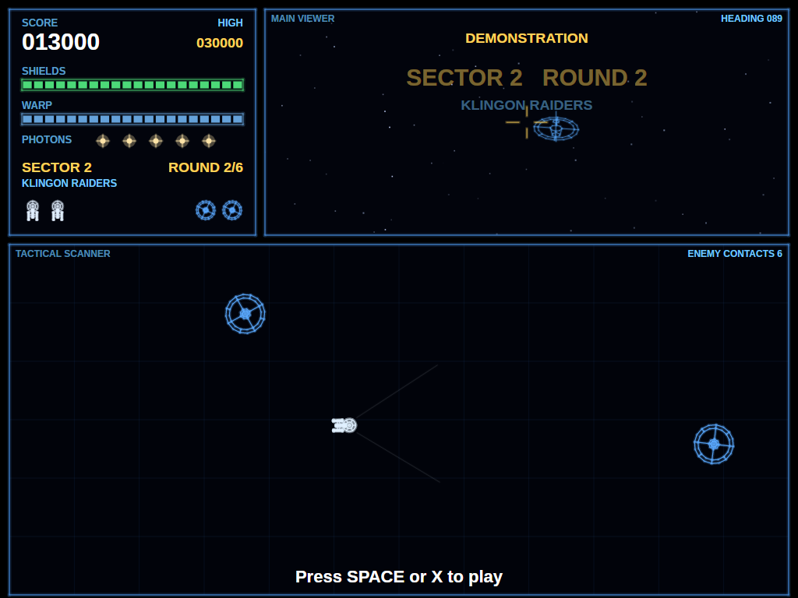
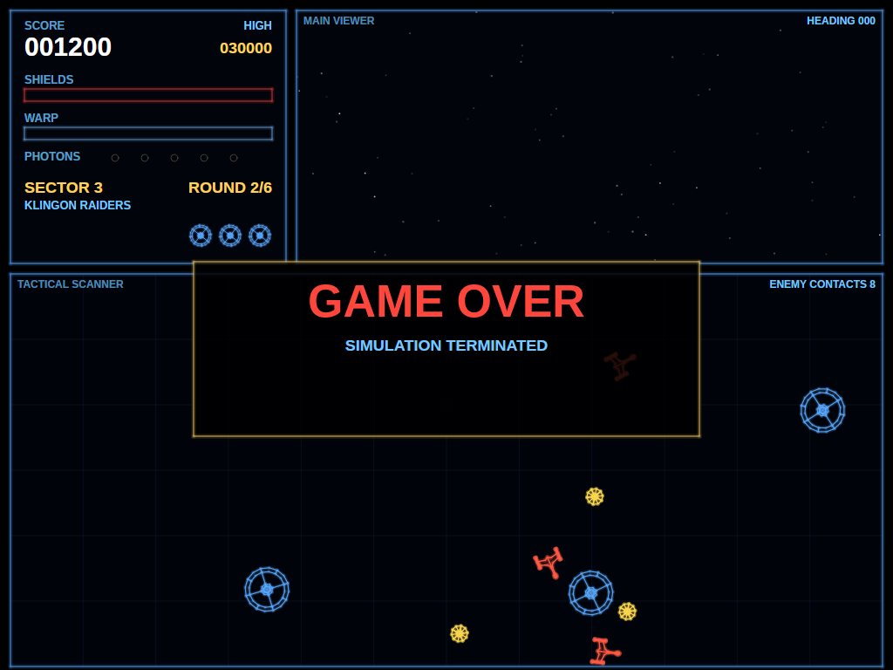
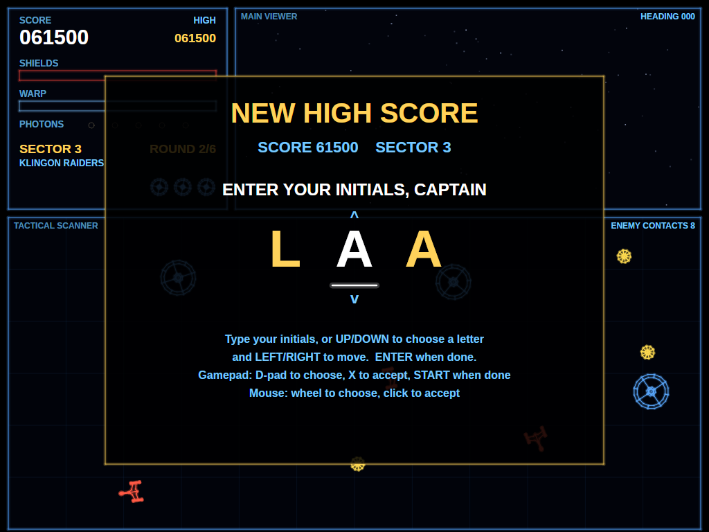
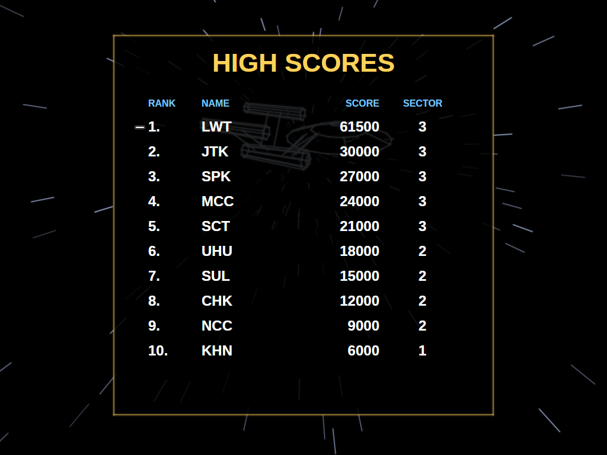

# AVATrek

A recreation of Sega's 1983 vector arcade game **Star Trek: Strategic Operations Simulator**, built with
.NET 10 and Avalonia UI. Command the Enterprise through sector after sector of Klingon battle cruisers,
anti-matter saucers and the rogue probe Nomad. Fly by the tactical scanner, fight through the main
viewer, and make your shields, photon torpedoes and warp energy last: they only come back when you dock
at a starbase, and every starbase you don't need is worth a bonus.

## Features

- **The cabinet's split screen**: a status panel and the first-person **main viewer** across the top,
  the overhead **tactical scanner** below, both showing the same battle at the same moment.
- **A real 3D viewer**: every ship is a wireframe model, drawn flat from above on the scanner and in
  perspective out of the bridge window, with a star field that turns with you, space dust that streams
  past at speed, and stars that stretch into streaks at warp.
- **Phasers and photon torpedoes**: phasers fire instantly and repeat while held; torpedoes are
  limited, slower, and burst with a blast that catches everything near.
- **Warp drive**: a burst of speed that makes the Enterprise untouchable and lets it ram straight
  through anything small, but warp energy drains fast.
- **Shields that run out**: with the shields at zero, the next hit destroys the ship.
- **Starbases**: fly into one to dock and refill everything. Each can be used once, the Klingons shoot
  at them, and any left unused at the end of a sector pay a bonus.
- **Six rounds per sector**, as on the cabinet: Klingon patrols, raiders and battle groups, a swarm of
  anti-matter saucers that latch on and drain the shields, a combined attack, and Nomad, a tough
  mine-laying probe, to finish. Everything gets faster and more numerous up to the tenth sector.
- **Spoken reports** ("Klingon vessels approaching", "Shields failing, Captain", "Docking complete")
  given the grainy sound of an early-80s speech chip.
- **Synthesised sound effects**: phasers, torpedoes, disruptors, a red-alert klaxon, warp and impulse
  engines, and the bridge's background hum and computer chirps, all generated by small scripts you can
  edit.
- **Attract mode**: leave the title screen alone for 20 seconds and a computer captain plays a silent
  demonstration.
- **Top-ten high-score table** with arcade-style initials entry (keyboard, gamepad or mouse).
- **Mouse spinner mode**: press **Tab** and sliding the mouse left and right turns the ship, like the
  cabinet's weighted dial, with the pointer hidden and kept in the window so it never runs out of room.
- **Keyboard, mouse and gamepad** (Xbox, PlayStation, Switch Pro and other SDL2 controllers,
  hot-plugged).
- **Any window size**: the 4:3 screen scales to fit, letterboxed. **Ctrl+S** saves a screenshot.
- **One self-contained executable** per platform: Windows, macOS and Linux on Intel/AMD and ARM.

## Screenshots

| Title screen | Klingon battle group | Anti-matter saucers |
|:------------:|:--------------------:|:-------------------:|
|  |  |  |
| The Enterprise turns over a warp-speed star field, with who's who and what they're worth. | Phasers lock on to a Klingon cruiser, shown in the viewer and on the scanner at once. | A swarm of saucers dives at the ship. Let one touch the hull and it clamps on. |

| Nomad | Docking | Warp |
|:-----:|:-------:|:----:|
|  |  |  |
| The sixth round of every sector: Nomad lurches round the sector sowing mines. | Fly into a starbase's centre and everything is topped up, but that base is gone. | The stars stretch into streaks, and a trail of light follows the ship on the scanner. |

| Attract mode | Game over |
|:------------:|:---------:|
|  |  |
| Left alone, the game plays itself, silently, until you press fire. | Simulation terminated. |

| Entering initials | The high-score table |
|:-----------------:|:--------------------:|
|  |  |
| A score that makes the top ten earns three initials, typed or dialled in arcade style. | The new entry flashes in the table, which also appears between the title screen and the demo. |

## Download and run

Ready-to-run builds for Windows, macOS and Linux, on both Intel/AMD and ARM, are on the
[Releases page](https://github.com/Harlock123/AVATrek/releases). **Latest build** is rebuilt on every
push to `main`. Each download is one self-contained executable: no .NET install is needed.

```bash
tar -xzf AVATrek-linux-arm64.tar.gz     # or linux-x64, linux-arm, osx-arm64, osx-x64
./AVATrek
```

On Windows, unzip `AVATrek-win-x64.zip` (or `-win-arm64`, `-win-x86`) and run `AVATrek.exe`. On macOS,
if Gatekeeper refuses to open it, run `xattr -d com.apple.quarantine AVATrek` once.

### Linux: sound and gamepads

- **Sound** needs `aplay`, from the `alsa-utils` package. Without it the game runs but is
  silent. Minimal installs (Arch, Omarchy, some Raspberry Pi images) don't include it:

  ```bash
  sudo apt install alsa-utils             # Debian / Ubuntu / Raspberry Pi OS
  sudo pacman -S --needed alsa-utils      # Arch / Omarchy
  ```

- **Gamepads** use SDL2. It is bundled for Windows, macOS and Intel/AMD Linux, but **ARM Linux builds need it
  installed**. Without it the keyboard still works; only the controller does not:

  ```bash
  sudo apt install libsdl2-dev            # Debian / Ubuntu / Raspberry Pi OS
  sudo pacman -S --needed sdl2-compat     # Arch / Omarchy
  ```

  On Debian-based systems it has to be `libsdl2-dev`: the game looks for `libSDL2.so`, which
  the runtime-only `libsdl2-2.0-0` package doesn't provide.

## Requirements

- .NET 10 SDK (to build; the released executables need nothing)
- Windows, macOS or Linux

## Building and Running

```bash
cd AVATREK
dotnet build
dotnet run
```

## Controls

The cabinet had a weighted spinner to turn the ship and four buttons: impulse, warp, phasers and
photon torpedoes.

### Keyboard

| Key | Action |
|-----|--------|
| **A** / **Left Arrow** | Turn left |
| **D** / **Right Arrow** | Turn right |
| **W** / **Up Arrow** | Impulse engines (thrust) |
| **Space** | Fire phasers (hold to keep firing) |
| **F** / **Z** | Fire a photon torpedo |
| **Shift** / **E** | Warp (hold) |
| **Esc** | Pause (Esc again to quit) |
| **M** | Mute all sound |
| **V** | Voice reports on/off |
| **Tab** | Mouse spinner mode on/off |
| **[** / **]** | Spinner sensitivity down / up (1–10) |

### Entering initials

| Key | Action |
|-----|--------|
| **A**–**Z**, **0**–**9**, **.** | Type a letter and move to the next |
| **Up** / **Down** | Dial the current letter |
| **Left** / **Backspace**, **Right** | Move between letters |
| **Space** | Accept the letter |
| **Enter** | Done |

Gamepad: D-pad dials and moves, **X** accepts, **Start** finishes. Mouse: the wheel dials, a click accepts.

### Mouse

| Input | Action |
|-------|--------|
| **Left Button** | Phasers |
| **Right Button** | Impulse |
| **Middle Button** | Photon torpedo |
| **Scroll Wheel** | Turn |
| **Move left / right** | Turn, in spinner mode |

#### Spinner mode

Press **Tab** to switch the mouse into spinner mode, the closest thing to the cabinet's weighted dial:
slide the mouse left and right to turn the ship, smoothly and as far as you like, while the buttons
still fire phasers, impulse and torpedoes. During play the pointer is hidden and kept near the middle
of the window, so it never stops at a screen edge; it comes back on the title screen and when
paused. **[** and **]** set the sensitivity from 1 to 10. Spinner mode and its sensitivity are
remembered between games, and the title screen shows which is set.

Keeping the pointer in the window uses `SetCursorPos` on Windows, `CGWarpMouseCursorPosition` on
macOS and `XWarpPointer` on Linux under X11 or XWayland. On a desktop that doesn't allow programs to
move the pointer, spinner mode still works, but the pointer can reach the edge of the screen.

### Controller (Xbox/PlayStation/Switch Pro)

| Input | Action |
|-------|--------|
| **Left Stick** / **D-Pad** | Turn, and push up for impulse |
| **A** / **Right Trigger** | Impulse |
| **X** / **Right Bumper** | Phasers |
| **B** / **Left Bumper** | Photon torpedo |
| **Y** / **Left Trigger** | Warp |
| **Start** | Pause / Resume game |
| **Back/Select** (while paused) | Exit game |

### Other

| Key | Action |
|-----|--------|
| **Ctrl+S** / **Cmd+S** | Save screenshot to Pictures folder |

## Gameplay

### The screen

- **Status panel** (top left): score and high score, the **shields** and **warp** gauges, the
  **photon torpedoes** left, the sector and round, spare ships and the starbases still standing. It
  flashes **RED ALERT** when the shields drop below a quarter.
- **Main viewer** (top right): the view over the bow, with a crosshair dead ahead. Everything on the
  scanner is here too, in perspective, if it's in front of you.
- **Tactical scanner** (bottom): the whole sector from above. It wraps at the edges. Two faint lines
  from the Enterprise show what the viewer can see.

### The Enterprise

- **Impulse** pushes the ship forward; let go and it coasts gently to a stop.
- **Phasers** hit the first thing along the line of fire, out to a fixed range. They never run out.
- **Photon torpedoes** fly further and burst with a blast that damages everything nearby. You carry
  five.
- **Warp** throws the ship forward at high speed. At warp nothing can hurt it, it destroys anything
  small it hits, and it shakes off any saucers clinging to the hull. Warp energy drains quickly.
- **Shields** soak up hits. When they are gone, the next hit destroys the ship.

### Starbases

Fly into the middle of a starbase, not too fast, to dock. Shields, torpedoes and warp energy are all
refilled, and anything on the hull is cleared off, but the starbase is used up. Klingons shoot at
starbases too, and enough hits destroy one. Every starbase still standing and unused when the sector
ends is worth a bonus, so the real decision is when you can afford to dock.

### The enemy

| Enemy | Behaviour |
|-------|-----------|
| **Klingon battle cruiser** | Circles at a distance and turns in to fire disruptor bolts. Some go after the starbases instead. Three phaser hits or one torpedo. Ramming one costs a lot of shield. |
| **Anti-matter saucer** | Small and quick. Dives at the ship and clamps onto the hull, draining the shields until it lets go, you go to warp, or you dock. Phasers can't reach one on the hull. |
| **Nomad** | The sixth round's boss: a big, tough probe that wanders the sector and sows mines behind it. |
| **Mine** | Laid by Nomad. Drifts, and explodes on contact. Can be shot. |

### Sectors and rounds

Each sector is six rounds: **Klingon Patrol**, **Klingon Raiders** (with a few saucers),
**Anti-Matter Saucers**, **Klingon Battle Group**, **Combined Attack** and **Nomad**. Clear a round
by destroying everything in it. Each sector begins with fresh starbases: three early on, fewer later.
The enemy grows faster, tougher and more numerous with each sector up to the tenth.

## How to play

1. **Watch the scanner, aim with the viewer.** The scanner tells you where everything is; the viewer's
   crosshair tells you what your phasers will hit.
2. **Keep moving.** Klingons fire where you are when they shoot. A ship that turns and thrusts
   is hard to hit.
3. **Phasers for everything small, torpedoes for Klingons in groups and for Nomad.** A torpedo into a
   cluster can take out several at once.
4. **Don't let saucers touch you.** Shoot them as they come in. If one latches on, a short tap of warp
   throws it off.
5. **Save warp for emergencies**: shaking off saucers, ramming through a pack, or escaping a mine field.
6. **Dock late.** A starbase is worth more unused, but not more than a ship. Head for one when the
   shields go red.
7. **Protect the starbases.** Klingons that go after them are worth chasing down.

## Scoring

| Action | Points |
|--------|--------|
| Anti-matter saucer | 200 |
| Klingon battle cruiser | 500 |
| Mine | 100 |
| Nomad | 3000 |
| Round complete | 500 × sector |
| Each unused starbase at the end of a sector | 1000 × sector |
| Extra ship | every 25,000 points (up to 6) |

## Sound Effects

All effects are synthesised by `tools/make_sounds.py`; nothing is sampled from the original
machine. The spoken reports are made by `tools/make_voice.sh` with the
[Piper](https://github.com/rhasspy/piper) text-to-speech engine and roughened by
`tools/crunch_voice.py` into the gritty, band-limited sound of a 1983 speech chip.

| Sound | When |
|-------|------|
| `Phaser.wav` | Phasers fire |
| `Torpedo.wav` / `TorpedoBlast.wav` | A torpedo launches / bursts |
| `Disruptor.wav` | A Klingon fires |
| `WarpIn.wav` | A Klingon or Nomad arrives in the sector |
| `KlingonBoom.wav`, `SaucerBoom.wav`, `MineBoom.wav`, `BigBoom.wav` | Things blowing up |
| `NomadHit.wav` | A hit that didn't finish something off |
| `ShieldHit.wav` | The shields (or a starbase) take a hit |
| `SaucerAttach.wav` | Saucers arrive, or one clamps onto the hull |
| `MineLaid.wav` | Nomad drops a mine |
| `ShipExplosion.wav` | The Enterprise is destroyed |
| `Impulse.wav` | Impulse engines (loops while thrusting) |
| `WarpEngage.wav` / `Warp.wav` | Going to warp / at warp (loops) |
| `Docking.wav` | Docking with a starbase |
| `RedAlert.wav` | Shields low, saucer and Nomad rounds |
| `RoundClear.wav` | A round or sector cleared |
| `ExtraShip.wav` | An extra ship |
| `Empty.wav` | Out of torpedoes |
| `Bridge.wav` | The bridge's background hum and computer chirps (loops during play) |
| `Voice*.wav` | The spoken reports |

## Project Structure

```
AVATREK/
├── AVATrek.csproj, AVATrek.slnx
├── Program.cs, App.axaml(.cs), MainWindow.axaml(.cs)
├── Engine/
│   ├── GameEngine.cs        # Game state, rounds and sectors, combat, docking, scoring
│   ├── Rounds.cs            # What each of a sector's six rounds sends, and the bonuses
│   ├── AttractPilot.cs      # The computer captain for attract mode
│   ├── HighScoreTable.cs    # Top-ten table, saved between games
│   ├── InitialsEntry.cs     # Arcade-style initials entry
│   ├── InputHandler.cs      # Keyboard, mouse and gamepad state
│   ├── MouseWarp.cs         # Moves the pointer back to the middle for spinner mode
│   ├── Settings.cs          # Spinner mode and sensitivity, saved between games
│   ├── ControllerManager.cs # SDL2 gamepad support
│   └── SoundManager.cs      # Effects, looping engine sounds, the voice queue
├── Models/
│   ├── Wireframe.cs         # The 3D line models: Enterprise, Klingon, saucer, starbase, Nomad, mine
│   ├── World.cs             # The wrapping sector: distances and directions
│   ├── Enterprise.cs        # The player's ship: impulse, warp, shields, torpedoes
│   ├── Enemies.cs           # Klingon, Saucer, Nomad, Mine
│   ├── Projectiles.cs       # Starbase, Torpedo, Disruptor, PhaserBeam
│   ├── Explosion.cs
│   └── GameObject.cs
├── Views/
│   ├── GameCanvas.cs        # Input, game loop, screen layout
│   ├── GameCanvas.Viewer.cs # The first-person main viewer
│   ├── GameCanvas.Screens.cs# Status panel, scanner, title, entry and table screens
│   └── GameCanvas.Draw.cs   # Glow lines, text, model drawing
├── Sounds/                  # Generated WAV files
├── Images/                  # README screenshots
└── tools/
    ├── make_sounds.py       # Synthesises the sound effects
    ├── make_voice.sh        # Speaks the voice reports with Piper
    └── crunch_voice.py      # Gives them the speech-chip sound
```

## Technical Details

- **Framework**: Avalonia UI 12.1 on .NET 10
- **Audio**: NetCoreAudio for cross-platform sound playback
- **Controller**: SDL2 GameController API for cross-platform gamepad support
- **Rendering**: a custom `Control` with `DrawingContext`. Every line is drawn twice, wide and faint and
  then thin and bright, for a vector-monitor glow.
- **3D**: the models are plain line lists in 3D. The scanner draws them from above; the viewer
  projects them through a 64° camera on the Enterprise's bow, clipping lines that pass behind it. The
  game itself is flat, so each model is tipped slightly toward the viewer to show its shape.
- **The sector** wraps at its edges; every distance and bearing is taken the short way round.
- **Screen**: a fixed 1024×768 screen, scaled to fit any window size with letterboxing
- **Game Loop**: 60 FPS using `DispatcherTimer`
- **High scores**: saved to `AVATrek/highscores.txt` in the user's application-data folder
  (`~/.config` on Linux, `%APPDATA%` on Windows, `~/Library/Application Support` on macOS)
- **Settings**: spinner mode and sensitivity in `AVATrek/settings.txt`, next to the high scores
- **Screenshots**: Captured using `RenderTargetBitmap` and saved as PNG

## Roadmap

### Done

- The split-screen bridge: status panel, 3D main viewer and wrapping tactical scanner
- Phasers, photon torpedoes, warp and impulse; shields, torpedoes and warp as limited resources
- Starbases: docking, refills, Klingon attacks and the unused-starbase bonus
- Six-round sectors with Klingons, anti-matter saucers, Nomad and his mines, rising to sector ten
- Synthesised effects, looping engine and bridge sounds, and speech-chip voice reports
- Attract mode, top-ten high scores with initials, screenshots, mute and voice toggles
- Mouse spinner mode with adjustable sensitivity, remembered between games
- Self-contained single-file releases for 8 platforms on every push to `main`

### Planned

- Optional tuning settings (starting ships, enemy speed)
- Two-player alternating games

## Credits

Star Trek: Strategic Operations Simulator was released by Sega in 1983. This is a fan recreation of its
gameplay; no code, graphics or sound from the original are used. Star Trek, the Enterprise, the
Klingons and Nomad are trademarks of their owners, and this project is not affiliated with or endorsed
by them.

The voice reports were made with Piper using the `en_GB-vctk-medium` voice, trained on the
[CSTR VCTK corpus](https://datashare.ed.ac.uk/handle/10283/3443) (CC BY 4.0), speaker p360.

## License

MIT License
